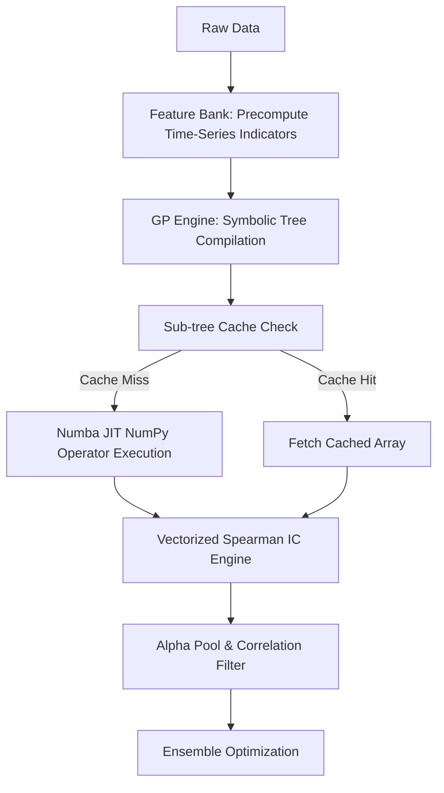

# Kế hoạch Thiết kế Kiến trúc GP Evolution V4 & Tối ưu hóa Tốc độ vượt trội

Kế hoạch này phác thảo các thay đổi kiến trúc cốt lõi cho **GP Evolution Engine V4** nhằm tăng tốc độ tính toán từ 10x đến 50x, chuyển đổi công nghệ tính toán từ Pandas sang NumPy chéo phẳng kết hợp Numba JIT và Feature Bank (WorldQuant-style).

---

## User Review Required

> [!IMPORTANT]
> - **Thay đổi cấu trúc cốt lõi**: Sẽ thay thế toàn bộ lõi thực thi Pandas trong `genetic_alpha_evolution_v3.py` bằng mảng NumPy 2D/3D dạng `(Ticker x Date)` và biên dịch JIT bằng Numba.
> - **Độc lập Đánh giá (Dual-Review)**: Kế hoạch này sẽ được chuyển giao cho **Claude Code CLI** và **Codex L3** phản biện. Sau khi cả hai chuyên gia phê duyệt, chúng ta mới tiến hành viết code.

---

## Proposed Changes

### 1. Xây dựng Feature Bank & Caching (WorldQuant-Style)
* **Feature Bank**: Tiền tính toán trước toàn bộ các chỉ báo kỹ thuật thời gian (`decay_linear`, `ts_rank`, `vol_ratio`, `rolling_std`, `rolling_mean`) trên toàn bộ vũ trụ cổ phiếu. Lưu trữ dưới dạng mảng NumPy 3D `(Feature x Ticker x Date)` trong bộ nhớ RAM trước khi khởi chạy tiến hóa GP.
* **Sub-tree Caching (Memoization)**: Thiết lập bộ nhớ đệm băm (Hash Map) để lưu kết quả thực thi của các biểu thức con. Các biểu thức trùng lặp (ví dụ: `stddev(close, 20)`) trong cùng thế hệ sẽ được lấy trực tiếp từ cache mà không cần tính toán lại.

### 2. Vector hóa hoàn toàn Fitness (Spearman daily IC)
* **Loại bỏ Groupby Loop**: Thay vì dùng vòng lặp `.groupby('date')` của Pandas rất chậm, chúng ta sẽ chuyển đổi dữ liệu thành mảng NumPy 2D. Xếp hạng tín hiệu chéo phần (cross-sectional rank) bằng phép toán ma trận NumPy.
* **Vectorized Spearman IC**: Tính toán hệ số tương quan Pearson trên các mảng đã được xếp hạng (Spearman IC chéo phẳng) đồng thời cho tất cả các ngày giao dịch bằng vector hóa ma trận.

### 3. Tăng tốc bằng Numba JIT & NumPy
* Biên dịch các hàm xử lý tính toán rolling và tương quan thắt nút cổ chai bằng `@njit(fastmath=True, parallel=True)`.
* Chuyển toàn bộ dữ liệu đầu vào của các toán tử từ Pandas DataFrame sang mảng NumPy 2D để giải phóng hoàn toàn GIL (Global Interpreter Lock).

### 4. Thiết kế Luồng Xử lý V4 (Pipeline)

---

## Proposed Files

### [NEW] [genetic_alpha_evolution_v4.py](file:///c:/Users/GHC/repos/OMEGA_QUANT/scripts/genetic_alpha_evolution_v4.py)
* Phiên bản cải tiến chứa kiến trúc GP V4, tích hợp Feature Bank, Numba JIT và Vectorized Spearman IC.

### [NEW] [tests/test_genetic_alpha_evolution_v4.py](file:///c:/Users/GHC/repos/OMEGA_QUANT/tests/test_genetic_alpha_evolution_v4.py)
* Bộ unit test và regression test cho lõi tính toán V4.

---

## Verification Plan

### Kiểm thử hiệu năng (Benchmarking)
* Viết script đo đạc hiệu năng so sánh tốc độ thực thi (evaluations per second) giữa V3 (Pandas/Threads) và V4 (NumPy/Numba/Feature Bank) trên cùng một tập con dữ liệu.
* Chỉ tiêu nghiệm thu: **Tốc độ thực thi của V4 tăng tối thiểu 10x** so với V3.

### Kiểm định tính đúng đắn (Equivalence Check)
* Đảm bảo các giá trị Spearman IC, Fold IR tính toán từ V4 khớp chính xác tuyệt đối (lên tới 6 chữ số thập phân) so với kết quả của động cơ V3.

---

## Repo-Local Source Evidence

- **Role file read**: `.agents/agent/machine-learning-engineer.md`
- **Skill files read**:
  - `.agents/skills/python-patterns/SKILL.md`
  - `.agents/skills/clean-code/SKILL.md`
  - `.agents/skills/testing-patterns/SKILL.md`
  - `.agents/skills/performance-profiling/SKILL.md`
  - `.agents/skills/systematic-debugging/SKILL.md`
  - `.agents/skills/ml-dl-rl/SKILL.md`
  - `.agents/skills/backtesting-pit-safety/SKILL.md`
  - `.agents/skills/vietnam-market-data/SKILL.md`
- **Authoritative source contract**: Chỉ sử dụng role/skill docs từ `REPO_AGENT_ROOT` và `REPO_SKILL_ROOT` trong repo.

## Forbidden Path Scan

- Scanned non-authoritative paths: `.gemini\antigravity-ide\scratch\ag-kit`, `.openclaw\skills`, `C:\Users\GHC\.agents`, `.codex\memories`
- Result: Không phát hiện tham chiếu authoritative nào tới forbidden paths trong phạm vi kế hoạch V4 này.
