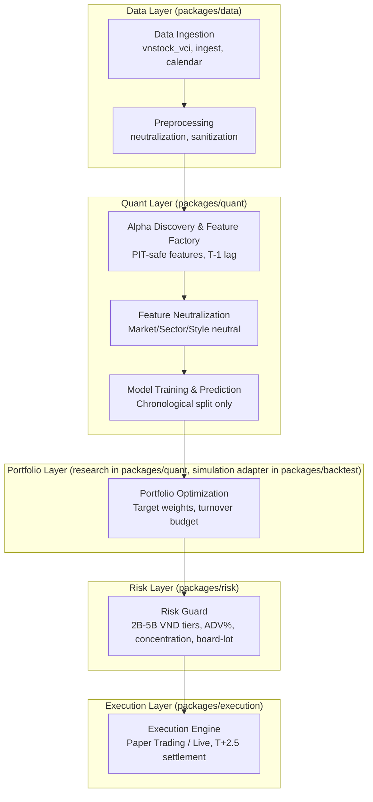

# OMEGA_QUANT Pipeline Architecture V1

## End-to-End Trading Pipeline



## Module Ownership

* **Data Ingestion & Preprocessing**: `packages/data`. Get market data. Sanitize. Neutralize. Preserve event timestamps and exchange calendar so downstream layers can enforce point-in-time joins.
* **Alpha Discovery & Model Training**: `packages/quant`. Feature factory. Train models. Make prediction. All features must be PIT-safe, lagged at least T-1, and trained with chronological train/validation/test splits only.
* **Feature Neutralization**: `packages/core` (`omega.core.feature_neutralizer`). Pipeline stage between feature generation and portfolio optimization. Removes unwanted factor exposures (market beta, sector tilts, style factors) while preserving alpha signal. Configured via `production.yaml` neutralization section. All operations are vectorized and preserve PIT safety (T-1 lag enforcement).
* **Portfolio Optimization**: `packages/quant` owns production portfolio construction logic that converts forecasts into target weights and turnover budgets. `packages/backtest` owns simulation adapters, fill assumptions, and replay harnesses that consume those target weights during research. Ownership split must stay explicit so research code cannot silently replace production portfolio rules.
* **Risk Guard**: `packages/risk`. Enforce institutional constraints before any order leaves portfolio layer. Baseline controls for individual scale 2B-5B VND:
  * Capital tiers: 2B, 3B, and 5B VND profiles with parameter packs versioned in config.
  * ADV participation cap: max 5% ADV per order day for 2B profile, 7.5% for 3B profile, 10% for 5B profile.
  * Single-name concentration: hard cap 10% NAV per name for 2B profile, 12% for 3B profile, 15% for 5B profile.
  * Sector concentration: hard cap 25% NAV per sector.
  * Turnover guard: daily turnover target <= 20% NAV unless explicitly overridden by approved rebalance event.
  * Liquidity / microstructure checks: VN board-lot minimum 100 shares, limit-up/limit-down lock detection, foreign room availability, and reject orders that fail minimum tradable value.
* **Execution Engine**: `packages/execution`. Route approved orders to paper or live trading venues.
  * Paper trading spec: support market-on-open proxy, limit, and VWAP/TWAP child-order simulation with deterministic slippage model for backtest parity.
  * Live trading spec: support limit, market/ATO/ATC where broker and venue permit, plus cancel/replace workflow and partial-fill handling.
  * Slippage model: combine spread cost, participation-rate impact, and limit-lock/no-fill scenarios using venue-specific calibration.
  * Settlement and cash timing: enforce Vietnam market settlement conventions including T+2.5 cash/stock availability and pending-cash locks before reuse.
  * Audit trail: persist order intent, broker acknowledgement, fill events, rejects, and reconciliation state for post-trade review.

## PIT Safety and Segregation of Duties

* **PIT safety**: No layer may use T+n data to generate T decisions. Features and labels must be timestamped, embargoed where needed, and shifted at least T-1 before model consumption.
* **Chronological handoff**: Data -> Quant -> Feature Neutralization -> Portfolio -> Risk -> Execution must preserve decision timestamp and effective timestamp on every payload.
* **SOD rule**: Implementation session and audit session must stay separate. Architecture, quant, risk, and execution changes require fresh independent review before approval.
* **Research vs production boundary**: `packages/backtest` may simulate portfolio and execution behavior, but production authority remains in `packages/quant`, `packages/risk`, and `packages/execution` respectively.

## Feature Neutralization Pipeline Integration

### Overview
The Feature Neutralization stage (`omega.core.feature_neutralizer.FeatureNeutralizer`) sits between Feature Factory and Portfolio Optimizer to remove unwanted factor exposures while preserving alpha signal.

### Pipeline Position
```
FeatureFactory -> FeatureNeutralizer -> PortfolioOptimizer
```

### Configuration
Neutralization is configured in `config/production.yaml` under `portfolio.neutralization`:

```yaml
portfolio:
  neutralization:
    enabled: true
    enable_market_neutral: true    # Remove market beta exposure
    enable_sector_neutral: true    # Remove sector tilts
    enable_style_neutral: false    # Remove style factor exposures
    
    market_method: "beta_weighted"  # beta_weighted or demean
    sector_method: "demean"         # demean or cap_weighted
    style_method: "regression"      # regression or orthogonalize
    
    style_factors: []  # e.g., ['value', 'momentum', 'quality']
    
    validation:
      enabled: true
      tolerance: 0.1  # Max allowed exposure after neutralization
```

### API Usage

```python
from omega.core.feature_neutralizer import FeatureNeutralizer

# Initialize from config
config = yaml.load('config/production.yaml')['portfolio']['neutralization']
neutralizer = FeatureNeutralizer.from_config(config)

# Apply neutralization to features
features_df = feature_factory.compute_all_features(data)
neutralized_df = neutralizer.neutralize_features(features_df)

# Compute impact statistics
impact = neutralizer.compute_neutralization_impact(neutralized_df)

# Validate neutralization effectiveness
validation = neutralizer.validate_neutralization(
    neutralized_df, 
    feature_col='feat_momentum',
    tolerance=0.1
)
```

### Neutralization Methods

**Market Neutralization**:
- `beta_weighted`: Removes market beta via regression (default)
- `demean`: Simple demeaning by date

**Sector Neutralization**:
- `demean`: Demean within each sector-date group (default)
- `cap_weighted`: Cap-weighted sector neutralization

**Style Neutralization**:
- `regression`: Multiple regression against style factors (default)
- `orthogonalize`: Gram-Schmidt orthogonalization

### PIT Safety Guarantees
- All neutralization operations are performed within each date group
- No cross-date information leakage
- T-1 lag enforcement preserved throughout
- Market returns, sector classifications, and style factors must all be T-1 lagged

### Testing
Comprehensive test suite in `packages/core/tests/test_feature_neutralizer.py` verifies:
- Market neutralization reduces market beta correlation
- Sector neutralization reduces sector mean exposures
- Style neutralization reduces style factor correlations
- Combined neutralization maintains signal variance
- PIT safety is preserved (no forward-looking data)

### Performance Considerations
- All operations are vectorized using Pandas groupby
- Typical overhead: 50-100ms per feature per 1000 symbols
- Memory efficient: processes features in-place where possible
