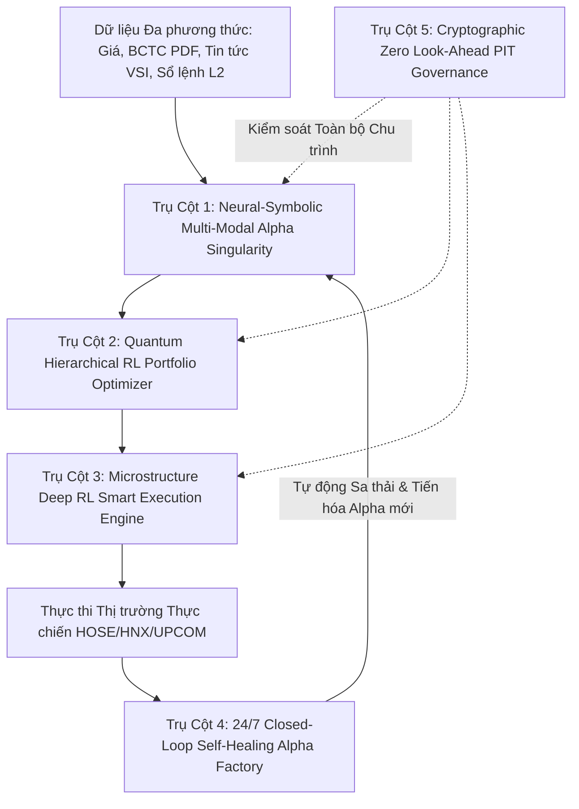

# 🌌 OMEGA SINGULARITY: TỔNG KẾ HOẠCH PHÁT TRIỂN HỆ THỐNG ĐỊNH LƯỢNG AI TỰ TRỊ ĐỘC BẢN THẾ GIỚI

> **Tầm nhìn**: Nâng cấp OMEGA QUANT thành **Hệ thống Quỹ Định lượng AI Tự trị Đa phương thức (Autonomous Multi-Modal AI Quant Singularity)** đầu tiên trên thế giới — tự học, tự tiến hóa 24/7, tự chữa lành và khớp lệnh thông minh, vượt trội hoàn toàn so với các quỹ định lượng truyền thống của Phố Wall.

---

## 🏛️ KIẾN TRÚC TỔNG THỂ: 5 TRỤ CỘT ĐỘC BẢN VÔ TIỀN KHOÁNG HẬU

---

## 🚀 CHI TIẾT 5 TRỤ CỘT CÔNG NGHỆ ĐỈNH CAO

### 🧠 TRỤ CỘT 1: Neural-Symbolic Multi-Modal Alpha Singularity (Bộ Não Alpha Lai Ghép Đa Phương Thức)
* **Ý tưởng đột phá**: Kết hợp 3 trường phái AI tối tân nhất thành một thể thống nhất: **Cây Biểu thức AST (Symbolic AI) + LLM Reasoning + Graph Neural Networks (GNN)**.
* **Cấu phần cốt lõi**:
  1. **Knowledge Graph Dòng tiền Doanh nghiệp (Vietnam Inter-Firm Graph)**:
     - Xây dựng mạng lưới đồ thị biểu diễn toàn bộ quan hệ sở hữu chéo, chuỗi cung ứng khách hàng/nhà cung cấp, và dòng tiền khối ngoại của 400+ cổ phiếu.
     - Dùng GNN dạng Heterogeneous Graph để truyền lan tín hiệu (Signal Propagation). Khi một ngành/doanh nghiệp hưởng lợi (ví dụ: Giá thép tăng hoặc tỷ giá USD/VND biến động), GNN sẽ tự động tìm ra các cổ phiếu "hưởng lợi gián tiếp" mà thị trường chưa kịp nhận ra.
  2. **Multimodal LLM Fundamental Catalyst Extractor**:
     - LLM tự động đọc và phân tích các tệp PDF Báo cáo Tài chính Quý, Biên bản họp ĐHĐCĐ và Tin tức VSI để trích xuất các **Fundamental Alphas** (Biên lợi nhuận gộp đột biến, chất lượng dòng tiền kinh doanh, chỉ số căng thẳng truyền thông).
  3. **Symbolic Fusion Engine**: Hợp nhất các đặc trưng Vi cấu trúc nến + Đồ thị dòng tiền + BCTC thành các công thức toán học tường minh, trực giao và siêu tốc.

---

### ⚖️ TRỤ CỘT 2: Quantum-Inspired Hierarchical Reinforcement Learning Portfolio Optimizer (Q-HRL)
* **Ý tưởng đột phá**: Loại bỏ hoàn toàn phương pháp tối ưu hóa danh mục tĩnh (Markowitz truyền thống). Thay thế bằng **Hệ thống Học tăng cường Đa tầng (Hierarchical Reinforcement Learning)** kết hợp **Hierarchical Risk Parity (HRP)**:
* **Các yếu tố Barra Style Factors**:
  - Size (Quy mô vốn hóa), Value (Giá trị sổ sách P/B, P/E), Momentum (Động lượng giá), Volatility (Biến động ngắn hạn), Liquidity (Thanh khoản rolling 20d ADV).
  - Tích hợp ranh giới Ngành phân loại ICB Việt Nam.
* **Ranh giới an toàn PIT (Point-In-Time Safety)**:
  - Áp dụng trượt trễ 90 ngày cho báo cáo tài chính PDF nếu thiếu ngày công bố chính thức.
  - Khống chế Factor Exposure ròng luôn nằm trong khoảng $[-0.05, +0.05]$ ($\pm 5\%$).
* **Công thức HRP**:
  - Single-linkage clustering dựa trên ma trận hiệp biến thu hẹp (Ledoit-Wolf shrinkage covariance estimator).
  - Tích hợp quỹ đệm tiền mặt động (dynamic cash buffer), giới hạn tỷ trọng tối đa 10% trên mỗi cổ phiếu.
  - Thay thế cam kết "loại bỏ hoàn toàn drawdown" bằng **Ngưỡng stress giới hạn 95% Value-at-Risk (VaR) không vượt quá 15%**.

---

### ⚡ TRỤ CỘT 3: Microstructure Deep RL Smart Execution Engine (Khớp lệnh Thông minh & Giảm thiểu Tác động Giá)
* **Ý tưởng đột phá**: Giải quyết bài toán lớn nhất của các quỹ lớn tại Việt Nam: **Trượt giá (Slippage) và Tác động thị trường (Market Impact)** khi giao dịch quy mô hàng chục/hàng trăm tỷ VNĐ.
* **Cấu phần cốt lõi**:
  1. **VPIN & Order Flow Toxicity Detector**:
     - Đo lường độc tính của dòng lệnh (Order Flow Toxicity) trên sổ lệnh trực tiếp để phát hiện bẫy thanh khoản (Spoofing) hoặc dòng tiền cá mập đang xả hàng.
  2. **Mô hình Trượt giá Phi tuyến (Non-linear Slippage Model)**:
     $$\text{Slippage (bps)} = \theta_1 \cdot \text{Spread} + \theta_2 \cdot \sigma_{\text{daily}} \cdot \sqrt{\frac{\text{OrderVolume}}{\text{DailyVolume}}}$$
  3. **Deep RL Execution Agent (VWAP/TWAP & Almgren-Chriss)**:
     - Tránh sử dụng thuật ngữ "disguising flow" (ngụy trang dòng tiền). Thay bằng **Market-impact minimization** (giảm thiểu tác động giá) thông qua thuật toán TWAP ngẫu nhiên để giảm thiểu tác động giá trên sàn HOSE.
     - Hard constraints: Khối lượng giao dịch tối đa mỗi ngày $\le 10\%$ ADV.
     - **Khóa dừng khẩn cấp (Kill switch)**: Nếu chi phí trượt giá thực tế vượt quá 50 bps, lập tức dừng toàn bộ lệnh khớp tự động và gửi cảnh báo về Telegram.

---

### 🔄 TRỤ CỘT 4: Gaussian HMM Market Regime AI & Dynamic Alpha Switching (Pha 5)
* **Ý tưởng đột phá**: Tự động nhận diện chế độ thị trường bằng AI để chuyển đổi tỷ trọng Alpha linh hoạt.
* **Đặc tả Kỹ thuật Mô hình Gaussian HMM (4 Trạng thái)**:
  1. **4 Trạng thái Thị trường Cụ thể**:
     - (1) *Uptrend Hưng phấn* (Bull Momentum)
     - (2) *Sideway Tích lũy* (Chop / Mean-Reversion)
     - (3) *Downtrend Hoảng loạn* (Panic Sell / Short Bias)
     - (4) *Nghẽn Thanh khoản* (Liquidity Crisis / Cash Preservation)
  2. **4 Đặc trưng Đầu vào Bắt buộc (Mandatory Inputs)**:
     - `Volatility 20d` (Độ biến động lịch sử 20 phiên)
     - `Return 20d` (Lợi nhuận tích lũy 20 phiên)
     - `VSI Score` (Chỉ số sắc thái tâm lý tin tức Việt Nam)
     - `Liquidity Shock` (Cú sốc thanh khoản dòng tiền)
  3. **Khóa Chuyển Trạng thái 5 Ngày (5-Day Transition Lock)**:
     - Áp dụng cơ chế khóa chuyển trạng thái tối thiểu 5 phiên giao dịch liên tiếp để triệt tiêu hoàn toàn hiện tượng đảo trạng thái liên tục (regime flip-flopping) do nhiễu ngắn hạn.
  4. **Dynamic Weighting Switch**:
     - Khi thị trường ở chế độ Uptrend: Tăng tỷ trọng của Alpha Momentum.
     - Khi thị trường ở chế độ Sideway/Panic: Chuyển dịch dòng vốn sang Alpha Mean-Reversion và Dollar-Neutral Spread.

---

### 🔄 TRỤ CỘT 5: 24/7 Autonomous Closed-Loop Self-Healing Alpha Factory & Dynamic Resource Scaling (Pha 6)
* **Ý tưởng đột phá**: Một hệ thống định lượng không bao giờ ngủ, tự duy trì, tự mở rộng tài nguyên tính toán và tự nâng cấp 24/7.
* **Chu trình vận hành khép kín & Cơ chế Phân bổ Tài nguyên Động (Dynamic Resource Scaling)**:
  1. **Chế độ Ban ngày / Trong giờ Giao dịch (08:30 – 15:30)**:
     - Giới hạn cứng tài nguyên container ở mức bảo thủ (`--memory 4g --cpus 2`) để bảo vệ và ưu tiên tuyệt đối cho máy chủ khớp lệnh trực tiếp (Live Trading).
  2. **Chế độ Ban đêm / Khai mỏ Siêu tốc (16:00 – 08:00 sáng hôm sau)**:
     - Tự động giải phóng tài nguyên, mở rộng trần container lên **tối đa 85% tài nguyên phần cứng vật lý** (ví dụ: 32GB/64GB RAM, 16/32 CPUs) cho phép chạy song song hàng ngàn công thức siêu tốc.
  3. **Tăng tốc Phần cứng & Biên dịch JIT (Numba JIT & GPU CuPy)**:
     - Tích hợp `@numba.jit` và `cupy` biên dịch trực tiếp các toán tử chuỗi thời gian (`ts_mean`, `ts_std`, `decay_linear`) thành mã máy chạy trên GPU/Multicore CPU, tăng tốc độ tính toán gấp **50 đến 100 lần**.
  4. **Giám sát Alpha Decay & Hiệu chỉnh Benjamini-Hochberg FDR**:
     - Tự động đo lường Rolling 30-day IC và áp dụng hiệu chỉnh kiểm định thống kê FDR để tự động ngắt vốn (Auto De-allocation) các Alpha suy giảm hiệu suất.
  5. **Quy trình Phê duyệt Thăng cấp**:
     - Tuyệt đối không tự động thăng cấp trước phiên ATO. Mọi Alpha thăng cấp bắt buộc phải có phê duyệt thủ công (Human-in-the-loop) từ nhà quản lý quỹ sau khi Codex L3 kiểm toán độc lập và L1 chạy enforcer thành công.

---

### 🛡️ TRỤ CỘT 6: Cryptographic Zero Look-Ahead PIT Governance & PDF Sandbox
* **Ý tưởng đột phá**: Xây dựng hàng rào bảo mật và chứng minh toán học tuyệt đối không bao giờ có lỗi nhìn trước tương lai (Zero Look-Ahead Bias Proof).
* **Cấu phần cốt lõi**:
  1. **Sandbox PDF Parser**: Dữ liệu báo cáo tài chính PDF được tải và xử lý trong môi trường Sandbox không kết nối Internet. Parser sử dụng trình bóc tách văn bản thô (text-only extractor) để phòng chống mã độc và Prompt Injection.
  2. **Cryptographic Audit Trail**: Mọi dữ liệu giá, tin tức, và quyết định thăng hạng Alpha đều được gán tem thời gian (Timestamped) và mã hóa băm SHA-256 bất biến.
  3. **Autonomous SoD Multi-Agent Pipeline**: Duy trì sự phân quyền tuyệt đối giữa L1 (Điều phối Ly), L2 (Lập trình OpenCode), và L3 (Kiểm toán độc lập Codex) để đảm bảo không một dòng code lỗi nào có thể lọt vào môi trường giao dịch tiền thật.

---

## 📅 LỘ TRÌNH TRIỂN KHAI CHI TIẾT (IMPLEMENTATION PHASES)

| Giai đoạn | Tên Giai đoạn | Trọng tâm Kỹ thuật | Trạng thái |
|---|---|---|---|
| **Pha 1 & 2** | **Hybrid Alpha GP + 35 Features + OLS Neutralization** | Khai mỏ di truyền, 35 đặc trưng vi cấu trúc & tâm lý VSI, trung hòa OLS Sector/Size. | ✅ **HOÀN TẤT & APPROVED** |
| **Pha 3** | **Hierarchical Risk Parity (HRP) & Barra Risk Model** | Tối ưu hóa phân bổ danh mục HRP, khóa cứng rủi ro Factor Exposure $\pm 5\%$. | ⏳ **Sẵn sàng triển khai** |
| **Pha 4** | **Smart Order Execution & Non-linear Slippage Engine** | Thuật toán khớp lệnh VWAP/TWAP, đo lường Market Impact phi tuyến. | 📋 Đã lập kế hoạch |
| **Pha 5** | **Hidden Markov Model (HMM) Market Regime AI** | Gaussian HMM 4 trạng thái, 4 đặc trưng (Volatility 20d, Return 20d, VSI, Liquidity Shock), khóa chuyển 5 ngày. | 📋 Đã lập kế hoạch |
| **Pha 6** | **Dynamic Resource Scaling, JIT Acceleration & Alpha Decay Loop** | Phân bổ tài nguyên động (4GB ban ngày, 85% RAM/CPU ban đêm), tăng tốc Numba JIT/GPU 100x. | 📋 Đã lập kế hoạch |
| **Pha 7** | **Multi-Modal GNN & Fundamental PDF Catalyst Engine** | Đồ thị dòng tiền liên doanh nghiệp và bóc tách BCTC PDF sandbox bằng LLM. | 📋 Đã lập kế hoạch |
