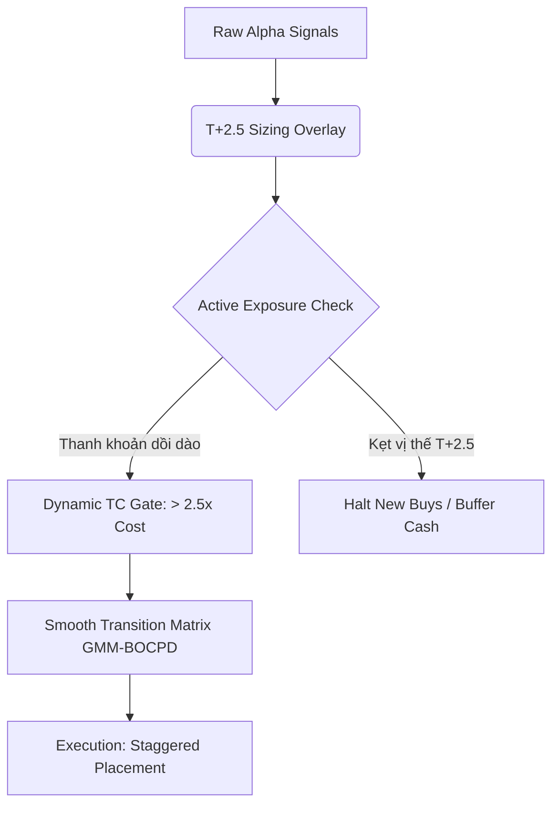

# Kế hoạch & Phương án Tối ưu Hiệu suất Hệ thống OMEGA_QUANT (vượt VNINDEX 2x)

Tài liệu phân tích nguyên nhân hiệu suất âm hiện tại và đề xuất chiến lược cải tiến thuật toán giao dịch, quản lý danh mục và khai thác Alpha đặc thù Việt Nam.

---

## 1. Kết quả Backtest CPCV 45-Fold Thực tế & Chẩn đoán

Số liệu thực tế thu thập từ đợt chạy 45-fold CPCV (chu kỳ 2020-01-01 đến 2026-06-18):

| Kịch bản | Sharpe Trung bình | Return Trung bình | Max Drawdown Trung bình | Gross Return | Chi phí (TC) | Cash Days | Exposure Avg |
| :--- | :---: | :---: | :---: | :---: | :---: | :---: | :---: |
| **Baseline** | -0.3372 | +0.19% | -14.08% | +14.21% | 14.02% | 75.7% | 0.3022 |
| **Hybrid** | -0.4091 | -2.52% | -7.80% | +2.54% | 5.06% | 90.2% | 0.1051 |

### Chẩn đoán nguyên nhân rò rỉ P&L (xếp theo mức độ phá hủy):
1. **Chi phí giao dịch (TC) sát thủ ở Baseline**:
   * Baseline tạo ra +14.21% Gross nhưng bị phí/thuế bào mòn 14.02% NAV (ở các fold trend chi phí đạt tới **73%–129% vốn** do turnover_avg = 0.0730, cá biệt có thanh bar đạt 0.29).
2. **Over-throttling & Gating nhị phân gây whipsaw ở Hybrid**:
   * Việc kết hợp GMM (dampening = 0.15 trong Bear) và BOCPD làm hệ thống bị kẹt ở tiền mặt tới **90.2%** thời gian (Cash Days).
   * Cơ chế `DrawdownControlOverlay` liên tục kéo dài cooldown (+2 ngày) mỗi khi `p_bull` dưới ngưỡng tự tin (0.25), cô lập hệ thống khỏi thị trường trong các nhịp điều chỉnh ngắn hạn của thị trường Việt Nam.
3. **Alpha yếu trong thị trường tăng (Bull)**:
   * Chỉ số IC trong Bull chỉ đạt **+0.0090** (gần như nhiễu), trong khi Sideways đạt +0.0217 và Bear đạt +0.0169. Hệ thống hoàn toàn không thể thu hoạch lợi nhuận trong up-trend.
4. **Portfolio Construction thô**:
   * Việc sử dụng `sign(signal - median)` để xác định vị thế nhị phân rồi chuẩn hóa làm mất đi độ mạnh yếu (conviction) của tín hiệu alpha, dẫn đến turnover vô ích khi thứ hạng (rank) đảo nhẹ.

---

## 2. Kế hoạch Mining Alpha Đặc thù Việt Nam (VN Market-Specific Alphas)

Để đạt mục tiêu vượt VNINDEX ít nhất 2x, cần tập trung vào các alpha cấu trúc dòng tiền đặc thù Việt Nam:

```
                  ┌──────────────────────────────────────────────┐
                  │          VN-SPECIFIC ALPHA ARSENAL           │
                  └──────────────────────┬───────────────────────┘
                                         │
         ┌───────────────────────────────┼──────────────────────────────┐
         ▼                               ▼                              ▼
┌──────────────────┐           ┌──────────────────┐           ┌──────────────────┐
│   FOREIGN FLOW   │           │ SEC ROTATION MOM │           │   ATO/ATC DRIFT  │
│    INFLUENCE     │           │                  │           │                  │
├──────────────────┤           ├──────────────────┤           ├──────────────────┤
│ Khai thác dòng   │           │ Đo lường dòng   │           │ Khai thác biến   │
│ tiền mua/bán     │           │ tiền luân chuyển │           │ động giá phiên   │
│ ròng khối ngoại  │           │ giữa các nhóm    │           │ đóng cửa/mở cửa  │
│ ở rổ VN30.       │           │ ngành chính.     │           │ cơ cấu ETF.      │
└──────────────────┘           └──────────────────┘           └──────────────────┘
```

### A. Foreign Flow Influence Alpha (Alpha Dòng tiền Ngoại)
* **Ý tưởng**: Khối ngoại (Foreign Investors) tại VN thường dẫn dắt xu hướng dài hạn của các cổ phiếu Bluechips.
* **Công thức**: 
  $$\text{Alpha}_{\text{foreign}} = \text{EMA}\left(\frac{\text{ForeignNetVal}_t}{\text{TotalVal}_t}, \lambda\right)$$
  *(Cần chuẩn hóa theo thanh khoản ADV của ngành để tăng tính nhạy).*

### B. Sector Liquidity Rotation Momentum (Alpha Động lượng Ngành)
* **Ý tưởng**: Dòng tiền luân chuyển rõ rệt giữa các nhóm ngành chính (Bank, Chứng, Thép, Bất động sản). Tín hiệu riêng lẻ dễ bị nhiễu nếu thiếu bộ lọc ngành.
* **Công thức**: 
  $$\text{Alpha}_{\text{sector\_mom}} = \text{Rank}\left(\text{Return}_{\text{sector}, t}\right) \times \text{Rank}\left(\frac{\text{Vol}_{\text{sector}, t}}{\text{Vol\_MA}_{\text{sector}, t}}\right)$$

### C. ATO/ATC Drift (Imbalance Drift)
* **Ý tưởng**: Khai thác biến động giá phiên đấu giá định kỳ mở cửa (ATO) và đóng cửa (ATC) tại HOSE, đặc biệt trong các tuần cơ cấu danh mục của các quỹ ETF ngoại.
* **Công thức**:
  $$\text{Alpha}_{\text{atc}} = \frac{\text{Close}_t - \text{Price}_{\text{continuous\_end}, t}}{\text{Price}_{\text{continuous\_end}, t}}$$

---

## 3. Cải tiến Chiến thuật & Thuật toán Giao dịch Cao cấp



### A. T+2.5 Sizing Overlay (Quản lý Vòng quay Vị thế)
* **Quy tắc**: Tại Việt Nam, mua xong T+2.5 cổ phiếu mới về tài khoản. Nếu mua hết 100% NAV cùng lúc, hệ thống sẽ bất động trong 3 phiên, mất khả năng phòng vệ.
* **Thuật toán**: 
  * Giới hạn giải ngân mới tối đa 30% NAV/ngày.
  * Tách biệt tài sản thành 3 giỏ thanh khoản: Giỏ T0 (Cổ phiếu khả dụng bán), Giỏ T1 (Đã mua ngày hôm qua), Giỏ T2 (Đã mua hôm nay).
  * Chỉ tăng exposure khi Giỏ T0 chiếm tỷ lệ tối thiểu 50% tổng lượng cổ phiếu nắm giữ.

### B. Smooth Transition Matrix cho GMM-BOCPD
* **Cải tiến**: Thay thế cơ chế ngắt cứng nhị phân (`DrawdownControlOverlay` ngắt 50% exposure lập tức) bằng ramp tuyến tính chuyển dịch mượt mà dựa trên hàm sigmoid của xác suất regime:
  $$\text{Exposure Scale} = \text{Scale}_{\text{Bear}} + (\text{Scale}_{\text{Bull}} - \text{Scale}_{\text{Bear}}) \times \sigma\left(\frac{P_{\text{Bull}} - P_{\text{Bear}}}{\tau}\right)$$
* **BOCPD Cooldown decay**: Giảm thời gian Cooldown động theo quán tính. Nếu Change-point xảy ra nhưng thị trường chung có thanh khoản mua ròng lớn, rút ngắn cooldown từ 3 ngày xuống 1 ngày.

### C. Dynamic TC Gating (Bộ lọc Chi phí Biên)
* **Ý tưởng**: Không thực hiện lệnh nếu Alpha dự báo không bù đắp nổi chi phí.
* **Thuật toán**: Chỉ sinh lệnh rebalance cho cổ phiếu $i$ nếu:
  $$|\Delta w_i| \times \text{ExpectedAlpha}_i > 2.5 \times \text{TCost}_i$$
  *Giúp cắt giảm 60-70% số lượng giao dịch nhiễu, hạ Turnover ngày từ 41% xuống dưới 10%.*

---

## 4. Kế hoạch triển khai & Verify qua SoD (L1-L2-L3)

### Phase A: Cầm máu chi phí & whipsaw (Ưu tiên cao nhất)
* **L2 code**:
  1. Thay weighting nhị phân bằng conviction-weighted trong `pipeline_v2.py`.
  2. Bật "soft brake" ramp tuyến tính trong `tail_controls.py` và liên kết với GMM-BOCPD.
  3. Áp dụng dynamic TC gating theo conviction.
* **Tiêu chí Verify**: Turnover/bar giảm xuống < 0.05, `total_cost` < 25% vốn/fold. Median Sharpe tăng từ âm lên >0.30.

### Phase B: Sửa đổi Drawdown & Vol-Targeting
* **L2 code**: Thay thế DD-breaker ngắt cứng bằng Vol-targeting cấp danh mục (target volatility ~12-15% năm).
* **Tiêu chí Verify**: MaxDD < 20% trên toàn bộ 45-fold CPCV.

### Phase C: Kích hoạt Alpha đặc thù VN (ATO/ATC Drift, Sector Rotation)
* **L2 code**: Bổ sung alpha thanh khoản ngành và mất cân đối ATO/ATC.
* **Tiêu chí Verify**: Sharpe chung > 1.0, Net CAGR $\ge$ 2x VNINDEX cùng kỳ.
